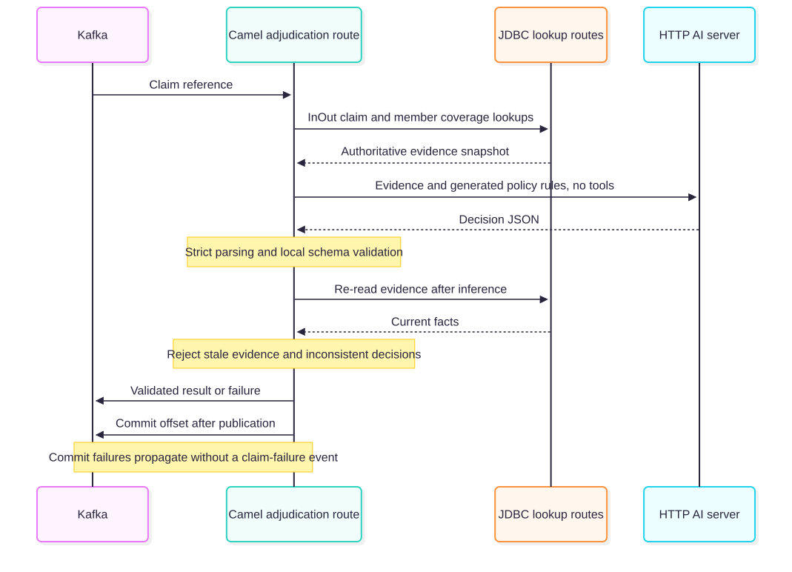
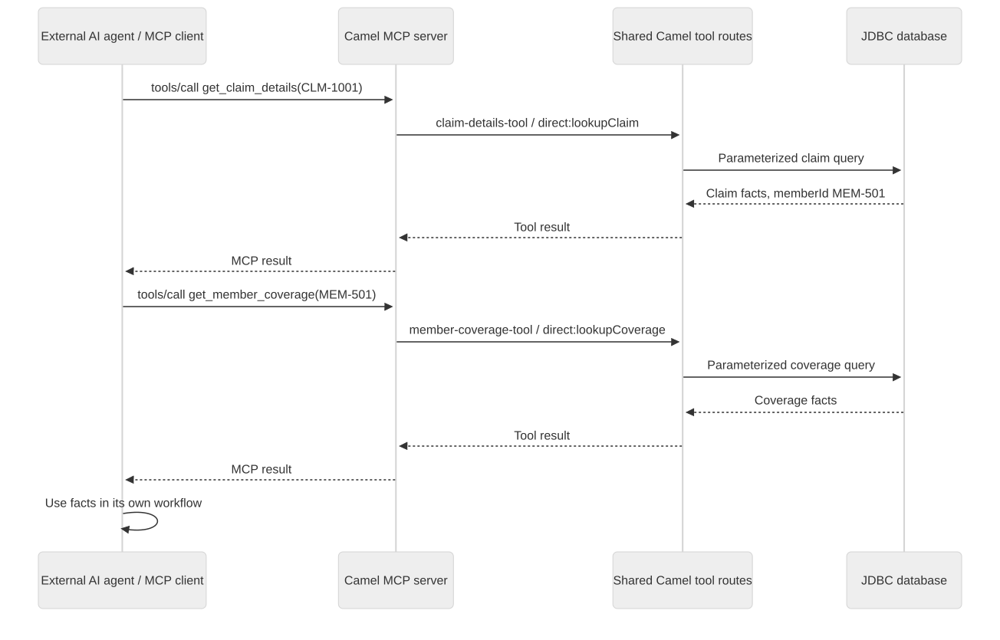
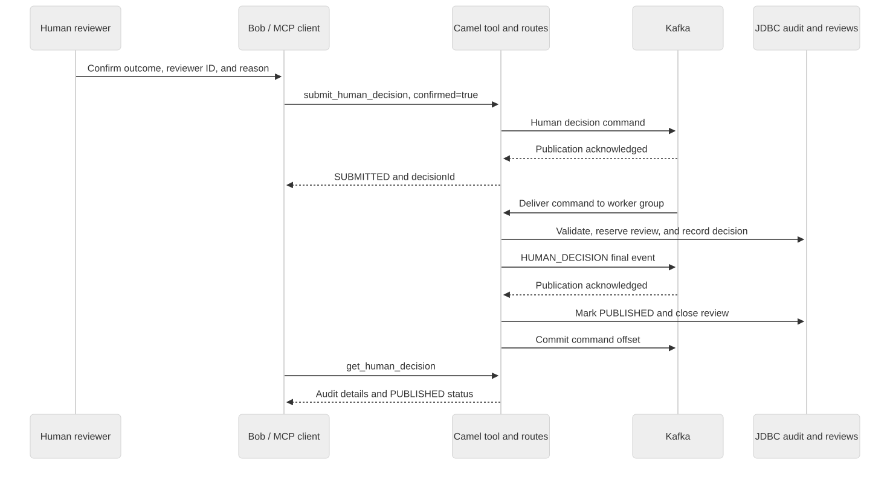

= Medical Claim Adjudication - Camel Spring Boot example

== Abstract

This example combines Kafka, Camel OpenAI, AI tools exposed through MCP, JDBC, and Enterprise Integration Patterns in one Spring Boot application. It demonstrates evidence-based AI recommendations, synchronous internal request/reply, human-confirmed review decisions, reliable result/failure routing, and concurrent processing across multiple instances of the same application.

== Introduction

Imagine an insurance company receiving medical claims from hospitals. Before evaluating a claim, it needs to find the claim details and check the patient's coverage. This example shows how Camel connects those steps with an AI model.

A hospital submits a claim reference through Kafka. The message says, essentially, "Please evaluate claim CLM-1001." It does not include all the information needed to make a decision.

The Camel application loads the claim and its member coverage through local JDBC lookup routes. These calls use *request/reply*: the calling route waits for each lookup and receives its result in the same Spring Boot application.

Camel sends the authoritative evidence to one HTTP AI call without tools. For example, a claim for EUR 120 with active coverage for the procedure and a EUR 500 limit should produce approval. Camel validates the response, rechecks that the evidence has not changed, and publishes a structured result through Kafka. An excluded procedure produces a denial; missing coverage requires manual review. Technical problems, such as an unavailable AI server after retries, produce a separate failure event.

`DecisionRules` is the ordered demo policy table. It generates the rule section of `prompts/adjudication.txt` and validates the model recommendation, so a policy change has one source. The model demonstrates constrained recommendations over supplied evidence; the synthetic policy is deliberately deterministic and can also be evaluated without a model.

The same two lookup tools are also published by the default MCP server. A third tool, `list_manual_reviews`, lets an external agent list cases needing human attention. A separate Camel consumer reads confirmed `MANUAL_REVIEW` results from Kafka into a JDBC review view. Bob can list these cases, retrieve their claim and coverage facts, and explain them to a reviewer. After a person verifies the missing information, Bob can call `submit_human_decision` with that person's explicit confirmation, reviewer ID, decision, and reason. Camel sends the decision command through Kafka, records the audit through JDBC, and publishes a final human decision. `get_human_decision` reports the processing status, and published decisions remove the case from the open review list.

The application then waits for the next claim.

An external agent can also call `get_flow_metrics` to inspect route activity, timing, JVM usage, and database connection pools. The observability starter exposes health and Prometheus metrics over HTTP, and the MCP tool reads the same Micrometer registry without requiring an OpenTelemetry agent or collector.

Several instances of the same application can share a Kafka consumer group. Kafka distributes claims between them, and each instance coordinates its own AI conversations and tool lookups. Human decisions use a shared JDBC database when processing across instances.

The example's purpose is to show *Camel coordinating events, AI requests, tools, database lookups, and failures*. The insurance rules and patient data are synthetic and deliberately simple.

=== Architecture and data flow

link:docs/diagrams/architecture.mmd[Mermaid source]

. Kafka delivers a claim reference to one consumer in the group.
. Camel validates the reference and retrieves claim details through `direct:lookupClaim` with `ExchangePattern.InOut`.
. Using the returned member reference, Camel retrieves coverage through `direct:lookupCoverage`.
. Camel supplies the authoritative evidence to one model call without tools. The shared rule table supplies the prompt and validates the recommendation.
. The response passes strict parsing and local schema validation. Camel re-reads the evidence after inference and rejects changes with `STALE_EVIDENCE`.
. Camel publishes a validated decision or a safe failure envelope, then commits the consumed offset after confirmed terminal publication.
. A `MANUAL_REVIEW` result creates an open review that an external agent can retrieve through MCP.
. After a human verifies the missing information and confirms a decision, the agent submits a command to Kafka.
. The human-decision worker records the audit, publishes the final result, and closes the selected review. The application continues listening for new events.

The default application serves MCP over HTTP on Undertow and calls the AI server over HTTP. Kafka carries claim submissions and terminal decisions, including the results consumed to build the manual-review view. Internal `direct:` request/reply remains in the same Camel context. The adjudication route and MCP tools share the same JDBC lookup routes. MCP clients can request dependent tool calls for their own conversations. The adjudication model receives evidence directly, avoiding a redundant gathering conversation and any claim that requested tool names prove evidence provenance.

link:docs/diagrams/adjudication-sequence.mmd[Mermaid source]

=== Kafka message flow

[cols="2,4",options="header"]
|===
| Topic | Messages
| `incoming-claims` | Claim references submitted for automatic evaluation.
| `adjudicated-claims` | Automatic outcomes, including `MANUAL_REVIEW`, and final `HUMAN_DECISION` events.
| `human-claim-decisions` | Human-confirmed decision commands submitted through MCP; keyed by review event ID.
| `failed-claims` | Technical failures and rejected human-decision commands.
|===

=== Using Camel components and EIPs

[cols="2,4",options="header"]
|===
| Starter | Responsibility
| `camel-spring-boot-starter` | Lifecycle, route discovery, and configuration
| `camel-kafka-starter` | Claim ingestion, human-decision commands, and terminal event publication
| `camel-openai-starter` | HTTP model calls over authoritative evidence
| `camel-ai-tool-starter` | Tool schemas, tag selection, and shared route execution
| `camel-mcp-server-starter` | Expose the tagged tool routes through the default MCP HTTP server
| `camel-observability-services-starter` | Micrometer route/JVM metrics and HTTP health/Prometheus endpoints
| `camel-jdbc-starter` | Bound SQL parameters for facts, review reservations, and decision audits
| `camel-jackson-starter` | JSON event, tool, and result conversion
| `camel-direct-starter` | Synchronous internal route composition
| `camel-mock-starter` | Test-only capture of outgoing messages
|===

The routes demonstrate Event-Driven Consumer, Pipes and Filters, Message Translator, Request/Reply, Content-Based Router, Correlation Identifier, and Dead Letter Channel. Correlation identifiers survive body changes in exchange properties. Missing records are explicit responses, not invented facts. Transient integration failures have bounded redelivery; invalid events and invalid recommendations are not retried. The decision path logs `claim_validated` after validation and `claim_published` only after confirmed Kafka publication.

For example, the local tool-to-lookup boundary is explicit in `ClaimToolRoutes`:

[source,java]
----
.to(ExchangePattern.InOut, "direct:lookupClaim")
----

The lookup uses a fixed query with `:?claimId` and the configurable `jdbc:dataSource?useHeadersAsParameters=true` endpoint. The model never supplies SQL. The MCP starter publishes those same tool routes through Spring AI's HTTP server integration.

== Trying out the example on your local machine

=== Prerequisites

* A JDK, Maven, Docker, and `curl` available on the host. Kafka command-line tools are included in the broker container.
* A reachable OpenAI-compatible chat-completions endpoint, valid credentials when required, and a model ID served by that endpoint. The model must follow the supplied decision rules and return decision JSON. Schema mode additionally requires strict JSON-schema output support in the inference runtime. The local walkthrough uses Ollama.
* For the local setup, free ports `9092` for Kafka, `8081` for the application's MCP server, and `9876` for health and metrics. Running Ollama locally additionally uses port `11434`; an existing remote inference endpoint uses its configured address.

=== Step 1: Open the example

Run from the `camel-spring-boot-examples` checkout:

[source,bash]
----
cd medical-claim-adjudication
----

=== Step 2: Start Kafka and create topics

Start the Kafka broker:

[source,bash]
----
docker run -d --name medical-claims-kafka \
  -p 127.0.0.1:9092:9092 apache/kafka:latest

docker logs medical-claims-kafka
----

If the container already exists and is stopped, use `docker start medical-claims-kafka` instead of creating it again. This preserves its topic history and committed offsets.

Wait until the broker is ready, then create the topics with the Kafka CLI:

[source,bash]
----
for topic in "${CLAIMS_INCOMING_TOPIC:-incoming-claims}" \
             "${CLAIMS_RESULTS_TOPIC:-adjudicated-claims}" \
             "${CLAIMS_FAILURES_TOPIC:-failed-claims}" \
             "${CLAIMS_HUMAN_DECISIONS_TOPIC:-human-claim-decisions}"; do
  docker exec medical-claims-kafka /opt/kafka/bin/kafka-topics.sh \
    --bootstrap-server localhost:9092 \
    --create --if-not-exists --topic "$topic" \
    --partitions 6 --replication-factor 1
done
----

The commands create six partitions per topic so the same setup can demonstrate multiple application instances. `--if-not-exists` preserves existing topic contents and does not increase an existing topic's partition count. Inspect the input topic before a scaling run:

[source,bash]
----
docker exec medical-claims-kafka /opt/kafka/bin/kafka-topics.sh \
  --bootstrap-server localhost:9092 \
  --describe --topic "${CLAIMS_INCOMING_TOPIC:-incoming-claims}"
----

These commands use the broker address inside the Docker container. With an external cluster, run its Kafka CLI tools against that cluster's broker address. Keep topic names consistent with `application.properties`; export the corresponding `CLAIMS_*_TOPIC` variables in each terminal when overriding them.

=== Step 3: Prepare the HTTP AI server

Choose an existing inference deployment or the local Ollama setup below. Apply the selected connection settings in the terminal used to start the application in Step 5.

==== Choose a suitable model

Use an instruction-tuned model that follows structured JSON instructions. Camel supplies the claim and coverage directly; automatic adjudication does not require tool calling. `src/main/resources/prompts/adjudication.txt` includes a `{{decisionRules}}` placeholder populated from `DecisionRules`. Custom prompts must retain that placeholder to receive policy updates.

Select a model that can reliably distinguish approval, procedure exclusion, an exceeded limit, and missing records. Provide enough memory and inference capacity for it to complete within `AI_REQUEST_TIMEOUT_MS`. Set `AI_TEMPERATURE` according to the selected model's recommended generation settings, then verify its decisions. An OpenAI-compatible endpoint establishes the API contract; validate the selected model's behavior with all sample outcomes in Step 7. Camel rejects malformed responses and recommendations that disagree with the database facts.

==== Run with Ollama

In another terminal, start Ollama if it is not already running:

[source,bash]
----
ollama serve
----

The commands below use `mimo-v2.6:9b` as an example model ID, not a model recommendation. Replace it with a model you have validated for this workflow. In the terminal used to start the application in Step 5, download and inspect your selected model:

[source,bash]
----
export AI_MODEL=mimo-v2.6:9b
ollama pull "$AI_MODEL"
ollama show "$AI_MODEL"
----

Keep an already-running Ollama server instead of starting another on the same port. To use a different server/model, export `AI_BASE_URL`, `AI_MODEL`, and `AI_API_KEY` in the terminal that starts the application. Ollama's default base URL is `http://localhost:11434/v1`; calls use the OpenAI-compatible chat-completion API.

==== Production alternatives to Ollama

For production deployments, consider these Red Hat offerings:

[cols="1,3",options="header"]
|===
| Offering | Purpose
| https://www.redhat.com/en/products/ai/fast-efficient-inference[Red Hat AI inference] | Run optimized inference and scale model serving across hybrid cloud infrastructure.
| https://www.redhat.com/en/products/ai/openshift-ai[Red Hat OpenShift AI] | Deploy, manage, and scale models and AI applications on a hybrid cloud platform.
|===

Deploy a model suited to this workflow and expose an OpenAI-compatible `/v1/chat/completions` endpoint that supports structured JSON recommendations. Configure the application in the terminal used for Step 5:

[source,bash]
----
export AI_BASE_URL=https://inference.example.com/v1
export AI_API_KEY='replace-with-your-inference-access-token'
curl --fail-with-body --silent --show-error "$AI_BASE_URL/models" \
  -H "Authorization: Bearer $AI_API_KEY"
export AI_MODEL='replace-with-your-deployed-model-id'
----

Replace the example address, access token, and model ID with the values from your deployment. `AI_BASE_URL` is the API base address ending in `/v1`; Camel appends `/chat/completions`. Select an instruction-following chat model from the returned model IDs. Run Step 7 against the selected model to verify its decisions. Camel uses the same routes and Kafka workflow with the configured inference endpoint.

==== Choose the model-output policy

`AI_OUTPUT_POLICY=compatibility` is the default. The final call asks for JSON without sending `response_format`. Camel trims whitespace and may unwrap one complete surrounding fence, either unlabelled or labelled `json`. Text outside the fence, nested fences, malformed/truncated JSON, duplicate keys, and trailing documents are rejected. Normalization is logged by event ID and never bypasses schema or business checks.

For a runtime/model deployment that you have verified supports strict structured output, set:

[source,bash]
----
export AI_OUTPUT_POLICY=schema
----

Only the final decision call sends `response_format.type=json_schema` with `strict: true` and the bundled `schemas/recommendation.json`. It advertises no tools. This mode rejects fences and never falls back to an unconstrained request on provider errors. Configuration rejects unknown policy names. The provider must enforce the requested constraint; an OpenAI-compatible URL or a model-list response does not prove support. Verify the installed provider/model before using this mode. Both modes validate the same schema locally using the existing Jackson-3-compatible NetworkNT dependency; the Jackson 2 `camel-json-validator` component is not added.

Each claim uses one inference request, with at most one redelivery by default. Every request has a timeout and a generated-token cap (`AI_MAX_TOKENS`, default `768`); the final response also has a UTF-8 byte limit (`AI_MAX_RESPONSE_BYTES`, default `16384`). Refusals, finish reasons other than `stop`, and outstanding tool calls fail validation. Size Kafka poll and shutdown budgets for inference, JDBC reads, retries, and publication. The default 900000 ms poll interval leaves headroom above the default two 60000 ms inference attempts. The token ceiling includes reasoning tokens on providers that count them; use the model's supported inference settings or raise the ceiling if responses finish with `length`.

Claim and coverage snapshots are compared before and after the final call without a database transaction spanning inference. This detects observed changes; it does not provide transactional isolation or detect a change that is reverted between reads. Database versioning and atomic finalization remain production work.

The current 4.22 MCP starter supplies the Jackson 3 schema validator transitively, so this example does not pin NetworkNT. One adapter exclusion remains until CAMEL-24369 is fixed in a published starter: allowing `mcp-json-jackson2` alongside Jackson 3 selects an incompatible validator through service loading and fails MCP tool registration with `NoSuchMethodError`. This is an upstream adapter-selection problem; removing the exclusion with the current 4.22 version prevents startup.

=== Step 4: Build and test

[source,bash]
----
mvn clean verify
----

Tests run the actual Camel OpenAI and AI Tool components against a scripted HTTP model endpoint, local `direct:` routes, and H2. Kafka boundaries use test endpoints. Tests do not require running Kafka, Ollama, model downloads, or external AI credentials. They cover the unchanged sample files, outcomes, currency mismatch, fenced responses, duplicate/trailing JSON, schema/type errors, refusals, truncation, oversized output, stale evidence, outbound strict-schema requests, unsupported approval, bounded retries, concurrent conversation isolation, internal replies, parameter validation, publication/commit ordering, MCP discovery/invocation over Undertow, review filtering/replay, pagination, review-write commit ordering, human confirmation, audit storage, concurrent decisions, duplicate/conflicting submissions, recovery, and final-publication failures.

Metrics tests cover route filtering, instance/context isolation, timer units, missing measurements, and reading real route metrics through MCP without additional inference or Kafka publication. The test management listener uses a random port.

The optional live-model test runs all unchanged sample files against your configured inference server, using the same Camel routes and temporary H2 fixtures. It keeps Kafka at mock boundaries and does not download models. It is excluded from the default build:

[source,bash]
----
AI_OUTPUT_POLICY=compatibility mvn -Dtest=ClaimModelIT test
# Repeat only after verifying the runtime supports strict structured output:
AI_OUTPUT_POLICY=schema mvn -Dtest=ClaimModelIT test
----

These checks verify the selected deployment's behavior on the samples; they are separate from a real Kafka walkthrough and do not establish support for other providers or models.

=== Step 5: Start the application

[source,bash]
----
java -jar target/camel-example-spring-boot-medical-claim-adjudication-*.jar
----

Alternatively, use `mvn spring-boot:run`. Wait for Undertow to start, all twenty-one routes to start, and the Kafka consumers to join their groups. The MCP endpoint is `http://127.0.0.1:8081/mcp` by default. Spring Boot initializes the synthetic database; the AI tool routes register before ingestion starts.

The observability starter also opens port `9876`: health is available at `http://127.0.0.1:9876/observe/health` and Prometheus metrics at `http://127.0.0.1:9876/observe/metrics`. Override the port with `MANAGEMENT_SERVER_PORT` when necessary.

The application remains listening until stopped; it does not automatically process every database row or exit after one claim.

=== Step 6: Submit a claim and inspect its result

In another terminal, start a Kafka consumer for decisions:

[source,bash]
----
docker exec -i medical-claims-kafka /opt/kafka/bin/kafka-console-consumer.sh \
  --bootstrap-server localhost:9092 \
  --topic "${CLAIMS_RESULTS_TOPIC:-adjudicated-claims}" \
  --from-beginning --property print.key=true
----

In a separate terminal, start a consumer for technical failures:

[source,bash]
----
docker exec -i medical-claims-kafka /opt/kafka/bin/kafka-console-consumer.sh \
  --bootstrap-server localhost:9092 \
  --topic "${CLAIMS_FAILURES_TOPIC:-failed-claims}" \
  --from-beginning --property print.key=true
----

Keep those consumers running. From another terminal in the example directory, publish the sample claim:

[source,bash]
----
docker exec -i medical-claims-kafka /opt/kafka/bin/kafka-console-producer.sh \
  --bootstrap-server localhost:9092 \
  --topic "${CLAIMS_INCOMING_TOPIC:-incoming-claims}" \
  < samples/approved.json
----

The approved sample should produce `APPROVED` on the decision consumer. If it appears on the failure consumer, inspect `errorCode` and `errorDetail` before continuing.

Each sample file contains exactly one JSON object on one line: the console producer treats each line as a separate Kafka record. Change `eventId` and `correlationId` for a new submission; publishing the same file again replays the same identifiers. Consumers started with `--from-beginning` also print historical outputs, so match results using those identifiers. For valid claim outputs, the printed key is the claim ID.

Input shape:

[source,json]
----
{
  "eventId": "evt-approved-001",
  "claimId": "CLM-1001",
  "correlationId": "demo-approved-001"
}
----

Expected business result fields:

[source,json]
----
{
  "eventId": "evt-approved-001",
  "claimId": "CLM-1001",
  "correlationId": "demo-approved-001",
  "outcome": "APPROVED",
  "reasonCodes": ["ACTIVE_COVERAGE", "PROCEDURE_COVERED", "WITHIN_LIMIT"],
  "policyVersion": "DEMO-POLICY-v1",
  "evidenceSource": "JDBC"
}
----

Automatic result and failure events also include `instanceId`, `processingMillis`, and `completedAt`. Decisions additionally include the provider-reported `model` and a `responseNormalized` flag indicating whether compatibility mode removed a surrounding fence. Match the result to its input using `eventId` and `correlationId`.

=== Step 7: Exercise other outcomes

[cols="2,2,3",options="header"]
|===
| Sample | Claim | Expected outcome
| `approved.json` | `CLM-1001`: EUR 120, active member, covered procedure, EUR 500 limit | `APPROVED`
| `excluded.json` | `CLM-1002`: procedure differs from the covered procedure | `DENIED`, `PROCEDURE_EXCLUDED`
| `over-limit.json` | `CLM-1003`: EUR 750 against a EUR 500 limit | `DENIED`, `LIMIT_EXCEEDED`
| `missing-coverage.json` | `CLM-1004`: referenced member has no coverage record | `MANUAL_REVIEW`, `MISSING_COVERAGE`
| `human-approval.json` | `CLM-1004`: a separate event for the human-approval walkthrough below | `MANUAL_REVIEW`, followed by a human-confirmed `APPROVED` through MCP
| `invalid.json` | No claim reference | `failed-claims`, `INVALID_EVENT`; no model call
|===

These samples match the bundled synthetic database fixtures. The business outcomes require a model that follows the decision rules; model failures appear on the failure topic instead.

[source,bash]
----
for sample in excluded over-limit missing-coverage invalid; do
  docker exec -i medical-claims-kafka /opt/kafka/bin/kafka-console-producer.sh \
    --bootstrap-server localhost:9092 \
    --topic "${CLAIMS_INCOMING_TOPIC:-incoming-claims}" \
    < "samples/$sample.json"
done
----

Inspect the result and failure consumers from Step 6. Match each record to its sample's event ID. Stop the console consumers with `Ctrl+C` when finished.

==== Simple scenario: manual approval with an MCP agent

This scenario uses the same missing-coverage claim with a separate event ID, so it can be reviewed independently of `missing-coverage.json`. The sample starts the review; the human approval is submitted later through the agent's MCP tool call.

. With the application running, submit the sample:
+
[source,bash]
----
docker exec -i medical-claims-kafka /opt/kafka/bin/kafka-console-producer.sh \
  --bootstrap-server localhost:9092 \
  --topic "${CLAIMS_INCOMING_TOPIC:-incoming-claims}" \
  < samples/human-approval.json
----
. In the result consumer from Step 6, wait for `eventId: evt-human-approval-001`, `outcome: MANUAL_REVIEW`, and `reasonCodes: ["MISSING_COVERAGE"]`.
. Connect Bob to the MCP server as described in Step 8 and follow the <<manual-approval-chat,example conversation>>. Select `evt-human-approval-001` explicitly, because other reviews can reference the same claim.
. For this synthetic demonstration, act as a reviewer who has verified enrollment outside the example database. Supply the approval, reviewer ID, and rationale, then explicitly confirm the decision.
. Expect `get_human_decision` to reach `PUBLISHED` for `dec-human-approval-001`. The result topic receives a `HUMAN_DECISION` event with `reviewEventId: evt-human-approval-001`, `outcome: APPROVED`, and `reasonCodes: ["HUMAN_APPROVED"]`. That event disappears from the open-review list; other unresolved events remain listed.

The approval does not add a coverage record. The agent must report the missing database record and wait for the human's decision. To repeat this scenario after resolving it, use fresh event and decision IDs as explained below.

==== Create a fresh case for human review

To repeat the human-review workflow after earlier cases have been resolved, submit a new event for the synthetic missing-coverage claim:

[source,bash]
----
REVIEW_EVENT_ID="review-$(date -u +%Y%m%dT%H%M%SZ)-${RANDOM}"
REVIEW_CORRELATION_ID="corr-$REVIEW_EVENT_ID"
printf '{"eventId":"%s","claimId":"CLM-1004","correlationId":"%s"}\n' \
  "$REVIEW_EVENT_ID" "$REVIEW_CORRELATION_ID" \
  | docker exec -i medical-claims-kafka /opt/kafka/bin/kafka-console-producer.sh \
      --bootstrap-server localhost:9092 \
      --topic "${CLAIMS_INCOMING_TOPIC:-incoming-claims}"
printf 'Submitted review event: %s\n' "$REVIEW_EVENT_ID"
----

Wait for its `MANUAL_REVIEW` result before asking the agent to list reviews. Distinct event IDs create separate reviews even when they reference the same claim. Reusing a previously resolved event ID does not reopen that review.

A valid manual-review recommendation is a business result. Technical failures use safe codes such as `AI_REQUEST_FAILED`, `DATA_LOOKUP_FAILED`, `INVALID_AI_RESPONSE`, and `RESULT_PUBLICATION_FAILED`. For an invalid model response, `errorDetail` identifies malformed JSON, unexpected fields, refusal, incomplete output, size limits, schema errors, or a recommendation that disagrees with the database facts. `STALE_EVIDENCE` means the facts changed during the final call; submit a fresh event after investigating the change. If neither terminal topic can be written, the input remains uncommitted and eligible for retry. Delivery is at least once: crashes/rebalances can repeat model calls and results. Deduplicate downstream using stable event IDs. Offset-commit failures propagate to Kafka and log `offset_commit_failed`; they do not publish a claim-failure event after a successful result.

=== Step 8: Discover and invoke the shared tools through MCP

Use an MCP client with Streamable HTTP support and connect it to `http://127.0.0.1:8081/mcp`. The server exposes:

* `get_claim_details`, with required string argument `claimId`.
* `get_member_coverage`, with required string argument `memberId`.
* `list_manual_reviews`, with optional integer arguments `limit` (default `20`, maximum `100`) and `offset` (default `0`).
* `submit_human_decision`, requiring `decisionId`, `reviewEventId`, `outcome`, `reviewerId`, `reason`, and `confirmed`.
* `get_human_decision`, with required string argument `decisionId`.
* `get_flow_metrics`, with optional exact `routeId`, returning this instance's route, JVM, and connection-pool metrics. See <<flow-metrics,metrics usage and interpretation>> below.

==== Use IBM Bob as an external AI agent

https://bob.ibm.com/[IBM Bob] can discover these tools and call the Camel routes from a chat request. The example includes link:.bob/mcp.json[`.bob/mcp.json`] with the MCP server connection already configured. Start the application as in Step 5, then launch Bob CLI from the example directory:

[source,bash]
----
bob
----

Bob loads the project MCP configuration automatically:

[source,json]
----
{
  "mcpServers": {
    "medical-claim-tools": {
      "type": "streamable-http",
      "url": "http://127.0.0.1:8081/mcp",
      "protocolNegotiation": "legacy"
    }
  }
}
----

The application must be running for Bob to discover the tools. If you change the application's MCP address, port, or path, update `url` in `.bob/mcp.json` to match.

For Bob IDE, open this example directory, enable *Use MCP Servers* in the Bob panel's MCP settings, and confirm that `medical-claim-tools` lists all six tools.

Send this prompt in Bob chat and approve the proposed tool calls:

[source,text]
----
Use the medical-claim-tools MCP server to list the manual reviews.
For the first review, retrieve its claim details and then its member coverage
using the returned memberId. Explain why human attention is needed, citing
only the returned facts. If the list is empty, say so. Report missing records
or tool errors explicitly.
----

Expect a call to `list_manual_reviews`, followed by dependent lookup calls for a listed case. After Step 7 produces a `MANUAL_REVIEW` result for `CLM-1004`, Bob can retrieve that claim and explain the missing coverage for `MEM-504`. The list is empty when no unresolved review events are present. Bob handles the MCP session automatically. Reconnect its MCP server after restarting the application or updating the available tools.

See https://bob.ibm.com/docs/shell/configuration/mcp/mcp-bobshell[Bob Shell MCP configuration], https://bob.ibm.com/docs/ide/configuration/mcp/mcp-in-bob[Using MCP in Bob IDE], and https://bob.ibm.com/docs/ide/configuration/mcp/server-transports[MCP server transports] for configuration details.

[[flow-metrics]]
==== Ask an external agent for metrics

With Bob or another MCP agent connected to the running application, ask:

[source,text]
----
Get the metrics.
----

The agent can discover `get_flow_metrics` from its name, description, and schema. Calling it with no arguments returns all application routes, sorted by route ID, together with JVM and database connection-pool metrics. The metrics tool's own route is excluded from the snapshot. The agent's presentation can vary; ask for particular fields if needed.

To inspect one route, ask:

[source,text]
----
Call get_flow_metrics with routeId: "claims-ingestion" and explain the results.
----

This calls the tool with `{"routeId":"claims-ingestion"}`. The route filter must exactly match an existing application route ID; unknown, blank, or malformed IDs return a tool error. JVM and connection-pool metrics are included even when filtering to one route.

[cols="1,3",options="header"]
|===
| Measurements | Available information
| Snapshot identity | Application instance, Camel context, snapshot time, and JVM start time
| Route activity | Route state; processed, succeeded, failed, and handled-failure exchanges; external redeliveries; exchanges currently in flight
| Route timing | Completed timing count, total and mean duration, and rolling-window maximum, in milliseconds
| JVM | Uptime in seconds, process CPU usage as a ratio, used and committed heap in bytes, and live thread count
| Database connection pools | Active, idle, maximum, and pending connections, plus connection-acquisition timing
|===

`get_flow_metrics` reads the existing Micrometer registry supplied by `camel-observability-services-starter`; no OpenTelemetry agent or collector is required. Reading metrics performs no inference, database query, claim submission, or decision submission, and does not reset counters.

Values describe the current application instance. Counters accumulate from meter registration and reset when the process restarts. Missing measurements are `null`, meaning unavailable rather than zero. Independent meter reads are not atomic, and timer maxima cover a rolling window. Route timings include nested work, so summing them does not give a claim's end-to-end duration.

Exchange successes and failures describe Camel processing. `DENIED` and `MANUAL_REVIEW` are business outcomes and do not themselves indicate a failed exchange. The tool does not provide per-claim history, approved/denied totals, or AI token usage. Reconnect the agent's MCP server after adding the tool or restarting the application so discovery is refreshed.

==== Inspect health and metrics directly

With the application running, inspect the management endpoints without an MCP session:

[source,bash]
----
export OBSERVE_URL="http://127.0.0.1:${MANAGEMENT_SERVER_PORT:-9876}/observe"
curl --fail-with-body --silent --show-error "$OBSERVE_URL/health"
curl --fail-with-body --silent --show-error "$OBSERVE_URL/metrics"
----

Health returns JSON; metrics returns Prometheus exposition text. The metrics endpoint exposes the registry's measurements, while `get_flow_metrics` selects route, JVM, and connection-pool measurements into a structured MCP response. Both can be used without an OpenTelemetry agent or collector. Submit the sample claims in Steps 6 and 7 before comparing route activity; idle routes can have missing measurements until first use.

==== Inspect MCP discovery with curl

The following `curl` commands demonstrate initialization, discovery, and invocation. Run them in the example directory while the application is running. Set `MCP_URL` to match any configured address, port, or path.

[source,bash]
----
export MCP_URL=http://127.0.0.1:8081/mcp
mkdir -p target

curl --fail-with-body --silent --show-error \
  --dump-header target/mcp-session.headers \
  "$MCP_URL" \
  -H 'Content-Type: application/json' \
  -H 'Accept: application/json, text/event-stream' \
  --data '{"jsonrpc":"2.0","id":1,"method":"initialize","params":{"protocolVersion":"2025-11-25","capabilities":{},"clientInfo":{"name":"claims-example-client","version":"1.0"}}}'

export MCP_SESSION_ID=$(awk 'tolower($1)=="mcp-session-id:" {print $2}' target/mcp-session.headers | tr -d '\r')

mcp_request() {
  curl --fail-with-body --silent --show-error "$MCP_URL" \
    -H 'Content-Type: application/json' \
    -H 'Accept: application/json, text/event-stream' \
    -H "Mcp-Session-Id: $MCP_SESSION_ID" \
    -H 'MCP-Protocol-Version: 2025-11-25' \
    --data "$1"
}

mcp_request '{"jsonrpc":"2.0","method":"notifications/initialized"}'
mcp_request '{"jsonrpc":"2.0","id":2,"method":"tools/list","params":{}}'
----

==== Call a Camel route from an external AI agent

After initializing the session above, invoke the claim lookup with this standalone command:

[source,bash]
----
curl --fail-with-body --silent --show-error "$MCP_URL" \
  -H 'Content-Type: application/json' \
  -H 'Accept: application/json, text/event-stream' \
  -H "Mcp-Session-Id: $MCP_SESSION_ID" \
  -H 'MCP-Protocol-Version: 2025-11-25' \
  --data '{"jsonrpc":"2.0","id":3,"method":"tools/call","params":{"name":"get_claim_details","arguments":{"claimId":"CLM-1001"}}}'
----

This executes `claim-details-tool`, which calls `direct:lookupClaim` using request/reply and returns the JDBC result to the external caller. The tool result's `content` contains JSON text with these business fields:

[source,json]
----
{"found":true,"claimId":"CLM-1001","memberId":"MEM-501","procedureCode":"PROC-A","billedAmount":120.00,"currency":"EUR"}
----

Use the returned `memberId` for the dependent lookup. The `mcp_request` function defined above sends the same headers:

[source,bash]
----
mcp_request '{"jsonrpc":"2.0","id":4,"method":"tools/call","params":{"name":"get_member_coverage","arguments":{"memberId":"MEM-501"}}}'
----

The coverage tool executes `member-coverage-tool` and `direct:lookupCoverage`. For `MEM-501`, it returns `found: true`, active coverage for `PROC-A`, currency `EUR`, a `claimLimit` of `500.00`, and policy `DEMO-POLICY-v1`.

An external AI agent can handle the fact-gathering part of a larger process by connecting its MCP client to `$MCP_URL` with Streamable HTTP transport. Give it a task such as: "Retrieve CLM-1001, use its member ID to retrieve coverage, and explain whether the procedure and amount match the coverage. Report missing data explicitly." Its MCP client performs initialization, discovers the schemas with `tools/list`, and issues the same `tools/call` requests shown here. Check the MCP result's `isError` flag and the tool payload's `found` field before using the facts.

link:docs/diagrams/mcp-lookup-sequence.mmd[Mermaid source]

The external agent uses the shared Camel lookup routes to gather facts for its own workflow. Submit a claim through Kafka as in Step 6 to run adjudication and publish the validated result.

See https://camel.apache.org/components/4.22.x/others/mcp-server.html[Camel MCP Server documentation] for how tagged AI tool routes are published.

==== List cases awaiting human review

After a `MANUAL_REVIEW` event appears on the result topic, use the initialized MCP session and the `mcp_request` function above:

[source,bash]
----
mcp_request '{"jsonrpc":"2.0","id":5,"method":"tools/call","params":{"name":"list_manual_reviews","arguments":{"limit":20,"offset":0}}}'
----

The tool invokes `direct:listManualReviews` with `ExchangePattern.InOut`, runs a parameterized JDBC query, and returns a page such as this after the missing-coverage sample succeeds:

[source,json]
----
{
  "reviews": [{
    "eventId": "evt-missing-coverage-001",
    "claimId": "CLM-1004",
    "correlationId": "demo-missing-coverage-001",
    "reasonCodes": ["MISSING_COVERAGE"],
    "completedAt": "2026-01-01T12:00:00Z",
    "decisionId": null,
    "reviewStatus": "OPEN"
  }],
  "limit": 20,
  "offset": 0
}
----

The timestamp reflects actual processing time. Results are ordered by completion time and event ID; increase `offset` for later pages. With no matching events, `reviews` is empty. Approved/denied claims and technical failures are excluded. Replaying the same event ID does not create another review. Distinct submissions of the same claim remain separate review events.

The view updates asynchronously after Kafka publication, so a new case can take a moment to appear. Each instance has its own review consumer group and resumes committed offsets against its persistent database. A new group starts at the earliest retained offset. Restarts, transient failures, and rebalances do not rewind the entire topic. To rebuild after removing the local database, stop the instance and set `CLAIMS_REVIEWS_GROUP_ID` to a fresh value before restarting. Give instances unique `CLAIMS_INSTANCE_ID` values and keep review groups distinct. Kafka retention bounds recovery. Malformed JSON, invalid review fields, oversized reasons, and conflicting human-decision events are logged as `review_projection_skipped` with topic, partition, and offset, then committed so later reviews can proceed. Correct and republish those records if needed. JDBC failures leave the offset uncommitted for retry. Stored review times use fixed nanosecond precision; listing casts timestamps for correct chronological ordering of older records too.

Published human decisions close their review cases. A case with a pending publication remains listed with `reviewStatus: PENDING` and its `decisionId` until its final result is confirmed.

==== Record a human decision and resolve a review

First inspect the claim and coverage information. On the coverage lookup, `found: false` means the example database has no matching coverage record; a human must verify the missing information before deciding.

Ask Bob to prepare the decision and wait for your confirmation:

[source,text]
----
List the open reviews for CLM-1004 and ask me which event ID to review.
Retrieve that claim and its member coverage, and explain any missing facts.
Ask me for APPROVED or DENIED, my reviewer ID, and my rationale.
Wait for my explicit confirmation before calling submit_human_decision.
Use a stable decisionId for retries, then check get_human_decision until
processing finishes and refresh the open review list.
----

[[manual-approval-chat]]
===== Example conversation: approve the Step 7 review

The following illustrates a conversation with Bob connected to `medical-claim-tools`. Tool results are summarized; wording and processing time vary. Use the actual event ID if you submitted a fresh event instead of `human-approval.json`.

[source,text]
----
You: Show me the manual review evt-human-approval-001. Retrieve its claim
     and coverage, explain why it needs attention, and wait for my decision.

Agent -> list_manual_reviews({"limit":20,"offset":0})
Agent -> get_claim_details({"claimId":"CLM-1004"})
Agent -> get_member_coverage({"memberId":"MEM-504"})
Agent: Review evt-human-approval-001 is OPEN for CLM-1004: PROC-A,
       EUR 120, member MEM-504. Coverage returned found=false.
       The reason is MISSING_COVERAGE. Please verify enrollment and provide
       your outcome, reviewer ID, and rationale. I have submitted no decision.

You: For this synthetic demo, I verified enrollment against the test
     documentation. Approve evt-human-approval-001 as demo-reviewer.
     Reason: Enrollment verified against the synthetic test documentation.

Agent: Confirm APPROVED for review evt-human-approval-001, reviewer
       demo-reviewer, with that reason? I will use dec-human-approval-001.

You: Yes, I explicitly confirm this approval.

Agent -> submit_human_decision({"decisionId":"dec-human-approval-001",
         "reviewEventId":"evt-human-approval-001","outcome":"APPROVED",
         "reviewerId":"demo-reviewer",
         "reason":"Enrollment verified against the synthetic test documentation.",
         "confirmed":true})
Tool: status=SUBMITTED
Agent -> get_human_decision({"decisionId":"dec-human-approval-001"})
Agent: The decision is PUBLISHED with outcome APPROVED.
Agent -> list_manual_reviews({"limit":20,"offset":0})
Agent: evt-human-approval-001 is no longer an open review.
----

If the selected review is not on the first page, the agent must request later pages using `offset`. After submission, it must check the recorded status until processing finishes; `SUBMITTED`, `found: false`, or `PENDING` do not establish completion. If processing is rejected or a tool fails, it must report that result rather than claim approval. Other open reviews for `CLM-1004` require separate decisions.

Select one review by its `eventId`; supply that value as `reviewEventId`. `claimId` identifies the claim, while `decisionId` identifies the human response. When several reviews reference the same claim, each needs its own decision.

After the reviewer explicitly selects `APPROVED` or `DENIED` and confirms a reason, Bob can invoke `submit_human_decision`. The following curl example illustrates a confirmed synthetic approval; use the review's actual event ID and the human's actual decision and rationale:

[source,bash]
----
mcp_request '{"jsonrpc":"2.0","id":6,"method":"tools/call","params":{"name":"submit_human_decision","arguments":{"decisionId":"human-decision-001","reviewEventId":"evt-missing-coverage-001","outcome":"APPROVED","reviewerId":"demo-reviewer","reason":"Enrollment verified against the synthetic test documentation.","confirmed":true}}}'
----

The tool returns `status: SUBMITTED` after Kafka confirms the command. A consumer validates it, reserves the review for one decision, and records the reviewer, outcome, rationale, and timestamp in JDBC. It publishes a `HUMAN_DECISION` event to `adjudicated-claims`, marks the decision `PUBLISHED`, and then commits the command's offset. The worker applies the human's confirmed outcome directly through JDBC and Kafka.

Check the recorded decision and refresh the open list:

[source,bash]
----
mcp_request '{"jsonrpc":"2.0","id":7,"method":"tools/call","params":{"name":"get_human_decision","arguments":{"decisionId":"human-decision-001"}}}'
mcp_request '{"jsonrpc":"2.0","id":8,"method":"tools/call","params":{"name":"list_manual_reviews","arguments":{}}}'
----

Submission is asynchronous. Before the worker records the command, `get_human_decision` can return `found: false`. The recorded status then describes processing:

[cols="1,3",options="header"]
|===
| Status | Meaning
| `PENDING` | The command is recorded; validation or publication is still in progress.
| `PUBLISHED` | The human decision was published to Kafka and the selected review is closed.
| `REJECTED` | The command could not be applied; inspect `errorCode`. `publishedAt` is populated after the rejection event is delivered.
|===

`DENIED` is a valid human outcome that can reach `PUBLISHED`; it is different from a rejected command. The resolved event disappears from the open list, while other review events for the same claim remain open. Recording a decision leaves the underlying claim and coverage facts unchanged and does not execute a payment.

Reuse the same decision ID and identical values when retrying, including after a timeout. A pending decision can be submitted again with those same values. An already-published command is ignored on replay. A different decision for an already-claimed review is rejected; reusing a decision ID with different values is also rejected. Business rejections are audited where the ID identifies a new submission and published to `failed-claims` with `HUMAN_DECISION_REJECTED`. JDBC or terminal-topic outages leave the command offset uncommitted. A crash between Kafka publication and its JDBC marker can repeat a final event; downstream consumers should deduplicate its stable event ID.

==== Verify the human decision on Kafka

The result consumer from Step 6 shows the final event with fields such as:

[source,json]
----
{
  "eventType": "HUMAN_DECISION",
  "eventId": "human-decision-001",
  "decisionId": "human-decision-001",
  "reviewEventId": "evt-missing-coverage-001",
  "claimId": "CLM-1004",
  "correlationId": "demo-missing-coverage-001",
  "outcome": "APPROVED",
  "reasonCodes": ["HUMAN_APPROVED"],
  "decisionSource": "HUMAN",
  "reviewerId": "demo-reviewer",
  "reason": "Enrollment verified against the synthetic test documentation.",
  "confirmed": true,
  "decidedAt": "2026-01-01T12:05:00Z",
  "completedAt": "2026-01-01T12:05:00Z"
}
----

Kafka retains the original `MANUAL_REVIEW` result and appends the human decision as a new event. Correlate them using `reviewEventId`; the original message remains in topic history.

To inspect submitted commands in another terminal:

[source,bash]
----
docker exec -i medical-claims-kafka /opt/kafka/bin/kafka-console-consumer.sh \
  --bootstrap-server localhost:9092 \
  --topic "${CLAIMS_HUMAN_DECISIONS_TOPIC:-human-claim-decisions}" \
  --from-beginning --property print.key=true
----

The command's key is the review event ID; the final result's key is the claim ID. Check the worker group's committed offsets and lag:

[source,bash]
----
docker exec medical-claims-kafka /opt/kafka/bin/kafka-consumer-groups.sh \
  --bootstrap-server localhost:9092 --describe \
  --group "${CLAIMS_HUMAN_DECISIONS_GROUP_ID:-medical-claim-human-decisions}"
----

The example records the caller-supplied reviewer ID and confirmation flag. They express confirmation rather than authenticate a human identity; production access control belongs at the MCP hosting platform. Audit reasons must use synthetic information in this demonstration.

link:docs/diagrams/human-decision-sequence.mmd[Mermaid source]

When finished, return to the terminal used for MCP initialization and close that session:

[source,bash]
----
curl --fail-with-body --silent --show-error -X DELETE "$MCP_URL" \
  -H "Mcp-Session-Id: $MCP_SESSION_ID" \
  -H 'MCP-Protocol-Version: 2025-11-25'
----

HTTP responses can use SSE framing (`data:` lines) around the JSON-RPC result. Keep the same session ID for all requests in a session.

=== Configuration

Edit `src/main/resources/application.properties`, or export its environment overrides before starting each application. Use matching topic names in the Kafka CLI commands. The observability starter supplies the management defaults; override those with standard Spring Boot management properties. Internal route names describe the application structure.

[cols="3,2,3",options="header"]
|===
| Setting | Environment override | Default
| Kafka brokers | `KAFKA_BROKERS` | `localhost:9092`
| Input/result/failure topic | `CLAIMS_INCOMING_TOPIC`, `CLAIMS_RESULTS_TOPIC`, `CLAIMS_FAILURES_TOPIC` | `incoming-claims`, `adjudicated-claims`, `failed-claims`
| Consumer group | `CLAIMS_GROUP_ID` | `medical-claim-adjudicator`
| Human decision command topic / worker group | `CLAIMS_HUMAN_DECISIONS_TOPIC`, `CLAIMS_HUMAN_DECISIONS_GROUP_ID` | `human-claim-decisions` / `medical-claim-human-decisions`
| Review-view consumer group | `CLAIMS_REVIEWS_GROUP_ID` | `medical-claim-reviews-${claims.instance-id}`
| External review tool tags | `CLAIMS_REVIEW_TOOL_TAGS` | `claims-review`
| Consumers per instance | `CLAIMS_CONSUMERS_COUNT` | `1`
| Poll batch / maximum poll interval | `CLAIMS_MAX_POLL_RECORDS`, `CLAIMS_MAX_POLL_INTERVAL_MS` | `1` / `900000` ms
| Instance identity | `CLAIMS_INSTANCE_ID` | `claims-1`
| MCP bind address / HTTP port | `CLAIMS_BIND_ADDRESS`, `CLAIMS_HTTP_PORT` | `127.0.0.1` / `8081`
| MCP path / tool execution timeout | `CLAIMS_MCP_PATH`, `CLAIMS_MCP_TOOL_TIMEOUT_MS` | `/mcp` / `20000` ms
| Management HTTP port / base path | `MANAGEMENT_SERVER_PORT`, `MANAGEMENT_ENDPOINTS_WEB_BASEPATH` | `9876` / `/observe`
| AI URL/model/key | `AI_BASE_URL`, `AI_MODEL`, `AI_API_KEY` | Local Ollama / `mimo-v2.6:9b` (example model ID) / local placeholder
| AI output policy | `AI_OUTPUT_POLICY` | `compatibility`; `schema` requires verified provider support
| AI token / response byte cap | `AI_MAX_TOKENS`, `AI_MAX_RESPONSE_BYTES` | `768` / `16384` UTF-8 bytes
| AI generation temperature | `AI_TEMPERATURE` | `0`
| AI HTTP timeout | `AI_REQUEST_TIMEOUT_MS` | `60000` ms
| Tool tags / prompt resource | `CLAIMS_AI_TOOL_TAGS`, `CLAIMS_SYSTEM_PROMPT` | `claims` / classpath prompt
| Redelivery count / delay | `CLAIMS_MAX_REDELIVERIES`, `CLAIMS_RETRY_DELAY_MS` | `1` / `1000` ms
| JDBC URL/driver/user/password | `CLAIMS_DB_URL`, `CLAIMS_DB_DRIVER`, `CLAIMS_DB_USER`, `CLAIMS_DB_PASSWORD` | H2 file under `data/` / H2 driver / `sa` / empty
| Connection pool size / acquisition timeout | `CLAIMS_DB_POOL_SIZE`, `CLAIMS_DB_CONNECTION_TIMEOUT_MS` | `4` / `5000` ms
| JDBC statement timeout | `CLAIMS_DB_QUERY_TIMEOUT_SECONDS` | `5` seconds
|===

MCP is enabled by default. `camel.mcp-server.tags` combines `claims.ai.tool-tags` and `claims.reviews.tool-tags`; only matching AI tool routes are published. The OpenAI route advertises no tools; lookup, review, and metrics tools are available to external MCP clients. The transport is configured through `spring.ai.mcp.server.*`.

The full `claims.kafka.*-endpoint`, `claims.reviews.input-endpoint`, `claims.human-decisions.*-endpoint`, `claims.ai.final-endpoint`, and `claims.jdbc.endpoint` properties can also be overridden. Keep manual commit, confirmed publication, error propagation, and timeout semantics consistent when changing endpoint options. The SDK's automatic retries are disabled so the Camel redelivery policy owns retries. Size Kafka's poll interval and graceful shutdown for the bounded inference and retry duration.

The default H2 database is stored in `data/medical-claims-<instance-id>.mv.db`, retaining pending decisions and audit records across application restarts. Every instance receives the same synthetic claim/coverage fixtures and can rebuild review closures using a fresh review group to replay retained automated and human Kafka results. An external database needs its JDBC driver, equivalent schema, and consistent records. When initializing that database separately, set `SPRING_SQL_INIT_MODE=never` to skip the bundled H2 initialization scripts. Keep real patient data and production credentials out of fixtures, prompts, and logs. When active coverage covers the procedure but its currency differs from the claim, the outcome is `MANUAL_REVIEW` with `CURRENCY_MISMATCH`; no conversion is attempted. Real insurance calculations remain outside the demo rules.

For multiple instances processing human decisions, configure a shared persistent JDBC datasource. The shared review reservation makes competing decisions mutually exclusive, and the command consumer group distributes work. Separate embedded databases are suitable for the single-instance human-review demonstration; Kafka replication of a read view does not provide a shared write lock.

== Demonstrating scalability

Stop the single instance from Step 5, then run the same JAR in multiple terminals with different instance IDs, MCP ports, and management ports, and the same consumer group. Apply the same AI connection, broker, and topic settings in each terminal:

Start one shared H2 TCP server first, using the H2 JAR matching the BOM (replace `/path/to/h2.jar` with its location). This server holds the common review reservations and decision audit for all three instances:

[source,bash]
----
java -cp /path/to/h2.jar org.h2.tools.Server -tcp -tcpPort 9093 -ifNotExists -baseDir ./data
----

[source,bash]
----
CLAIMS_DB_URL=jdbc:h2:tcp://localhost:9093/medical-claims CLAIMS_INSTANCE_ID=claims-1 CLAIMS_HTTP_PORT=8081 MANAGEMENT_SERVER_PORT=9876 java -jar target/camel-example-spring-boot-medical-claim-adjudication-*.jar
# In a second terminal:
CLAIMS_DB_URL=jdbc:h2:tcp://localhost:9093/medical-claims CLAIMS_INSTANCE_ID=claims-2 CLAIMS_HTTP_PORT=8082 MANAGEMENT_SERVER_PORT=9877 java -jar target/camel-example-spring-boot-medical-claim-adjudication-*.jar
# In a third terminal:
CLAIMS_DB_URL=jdbc:h2:tcp://localhost:9093/medical-claims CLAIMS_INSTANCE_ID=claims-3 CLAIMS_HTTP_PORT=8083 MANAGEMENT_SERVER_PORT=9878 java -jar target/camel-example-spring-boot-medical-claim-adjudication-*.jar
----

Start with one instance, then compare two and three under equivalent load. Each instance owns its AI conversations and local request/reply routes. Kafka distributes partitions; adding consumers beyond partition count does not increase partition concurrency. The shared tool routes and MCP endpoint scale with the application. Configure the shared JDBC datasource described above when exercising human decisions across instances. Each instance has its own HTTP listener and MCP session state; the manual commands use distinct ports.

Read `/observe/metrics` on each management port, or connect an MCP client to each instance and call `get_flow_metrics`. Each response describes only that instance; use `instanceId` and snapshot time when comparing activity across instances.

[source,bash]
----
RUN_ID="scale-$(date +%s)"
for i in $(seq 1 60); do
  claim_number=$(( (i - 1) % 4 + 1 ))
  printf '%s-%s|{"eventId":"%s-%s","claimId":"CLM-100%s","correlationId":"corr-%s-%s"}\n' \
    "$RUN_ID" "$i" "$RUN_ID" "$i" "$claim_number" "$RUN_ID" "$i"
done | docker exec -i medical-claims-kafka /opt/kafka/bin/kafka-console-producer.sh \
  --bootstrap-server localhost:9092 \
  --topic "${CLAIMS_INCOMING_TOPIC:-incoming-claims}" \
  --property parse.key=true --property 'key.separator=|'

docker exec medical-claims-kafka /opt/kafka/bin/kafka-consumer-groups.sh \
  --bootstrap-server localhost:9092 --describe \
  --group "${CLAIMS_GROUP_ID:-medical-claim-adjudicator}"
----

The workload uses unique event IDs as Kafka keys to distribute records across partitions. It cycles through the four synthetic claims; repeated references reuse the synthetic claim/coverage facts. Each distinct manual-review event also adds a row to the review view. Use the consumers from Step 6 to observe the output `instanceId` values and correlate all 60 terminal records with the generated run ID.

Repeat equivalent workloads with one, two, and three instances. Compare completion rate, `processingMillis`, tool durations in `tool_completed` logs, and consumer-group lag. Track failures and duplicate event IDs separately. Each accepted event should have a terminal decision or failure after recovery. Model-server capacity can limit throughput even when Kafka distributes claims across all instances. Stop one application instance to observe partition reassignment and continued processing by the others.

== Stop and clean up

Stop all application instances and console consumers using `Ctrl+C` and allow graceful shutdown. Both the MCP and management listeners stop with the application. Kafka topic history/offsets survive application restarts while the broker remains running.

[source,bash]
----
docker stop medical-claims-kafka
----

If this container was created only for the demonstration, remove it after stopping:

[source,bash]
----
docker rm medical-claims-kafka
----

The H2 files under `data/` retain the decision audit independently of the broker. Removing this demonstration broker container without persistent volumes discards its Kafka history. For a completely fresh demonstration, also remove the matching H2 files after stopping the application. After removing H2 files, configure a fresh `CLAIMS_REVIEWS_GROUP_ID` to rebuild reviews and published human decisions from retained Kafka results. Leave any pre-existing Ollama server running; stop only a server you started for this demonstration.

== Troubleshooting

* Broker unavailable: check container logs, host mapping, advertised listeners, and `KAFKA_BROKERS`.
* MCP listener unavailable: check `CLAIMS_BIND_ADDRESS`, `CLAIMS_HTTP_PORT`, and `CLAIMS_MCP_PATH`. Assign distinct ports to multiple instances. Use the initialize handshake before discovery or tool invocation.
* Management port already in use: assign a distinct `MANAGEMENT_SERVER_PORT` to each instance; changing `CLAIMS_HTTP_PORT` only changes the MCP listener.
* Metrics tool missing or measurements unavailable: rebuild and restart after adding `get_flow_metrics`, then reconnect the agent to refresh discovery. Check `/observe/health` and `/observe/metrics` on the instance's management port. Missing meters are returned as `null`; route activity can be absent before first use. Counters start over after an application restart.
* Tool/model errors: check that the configured model follows JSON instructions, MCP tools use the selected tags, and the HTTP server is reachable. Invalid or inconsistent recommendations go to the failure topic instead of being accepted.
* Slow inference: inspect AI-server load and memory, use a smaller workload, and adjust bounded timeouts/poll limits together. Raising application instance count cannot create additional model-server capacity.
* Invalid AI response: inspect `errorDetail` in the failure event. Check `AI_OUTPUT_POLICY`, the model's recommended `AI_TEMPERATURE` setting, its JSON instruction following, and its token ceiling. Schema mode needs runtime support for strict `response_format`; compatibility mode allows only a complete surrounding JSON fence. Match failures to fresh event IDs because `--from-beginning` also prints previous runs.
* Empty review list: only unresolved events are listed. Check for a new `MANUAL_REVIEW` result, allow the review consumer to catch up, and inspect `manual-review-projection` and its consumer-group lag. Use the fresh-event command in Step 7 to repeat an already-resolved scenario.
* Human decision stays pending: inspect `get_human_decision`, the human-decision consumer group, JDBC availability, and terminal-topic publication. Only `PUBLISHED` means the final decision was delivered.
* No apparent new results: use fresh event IDs, inspect the correct topics, and check group lag. The incoming-claim consumer resumes its committed offsets. The separate review projection resumes committed offsets; use a fresh review group to request a rebuild.

== Help and contributions

If you hit any problem using Camel or have feedback, https://camel.apache.org/community/support/[let us know].

We also love contributors, so https://camel.apache.org/community/contributing/[get involved].

The Camel riders!
